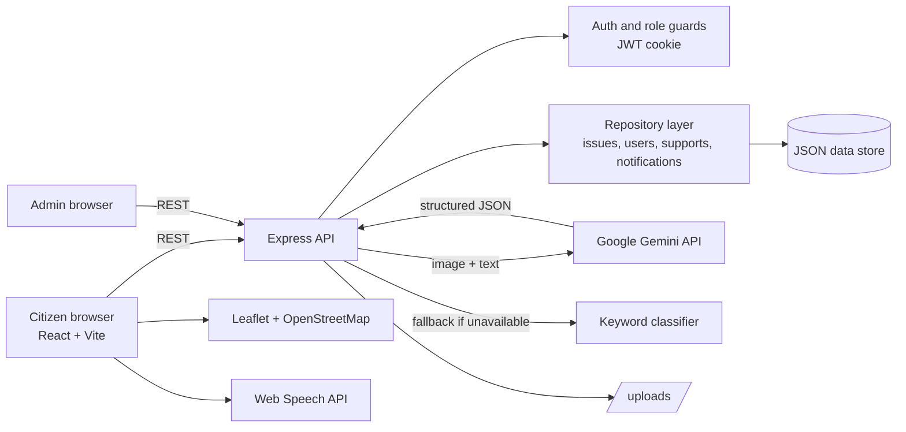

# CivicResolve [](https://github.com/civicresolve/civicresolve/actions/workflows/ci.yml)

**Transforming Civic Complaints into Real-World Solutions**
*குடிமக்கள் புகார்களை நிஜ உலகத் தீர்வுகளாக மாற்றுதல்*

> Your City. Your Voice. Your Impact.

An AI-powered, location-aware, community-driven platform that takes a civic complaint from **submission to tracking and resolution**. Built for **PromptWars x GDGoC PSG iTech 2026**, using Google Gemini.

[Demo Script (3-min)](DEMO.md) • [Implementation Details](IMPLEMENTATION.md) • [Security Policy](SECURITY.md) • [License](LICENSE)

---

## Table of contents
1. [Problem](#problem)
2. [Solution](#solution)
3. [Features](#features)
4. [Language support](#language-support-english-and-tamil)
5. [Voice assistant](#voice-assistant-tamil-and-english)
6. [How Google Gemini is used](#how-google-gemini-is-used)
7. [Architecture](#architecture)
8. [Tech stack](#tech-stack)
9. [Getting started](#getting-started)
10. [Demo walkthrough](#demo-walkthrough-for-judges)
11. [Security](#security)
12. [Accessibility](#accessibility)
13. [Testing](#testing)
14. [Data storage](#data-storage)
15. [Documentation & Links](#documentation--links)
16. [Assumptions and limitations](#assumptions-and-limitations)
17. [Future improvements](#future-improvements)

---

## Problem
Potholes, overflowing garbage bins, damaged streetlights, water leakage and poor drainage affect every community. Reporting them is hard: citizens don't know which department is responsible, how to describe the issue, how urgent it is, or whether anyone is acting on it. Authorities, in turn, receive unstructured complaints that are hard to categorise and prioritise.

## Solution
CivicResolve lets citizens report an issue in under a minute. **Google Gemini** reads the complaint (and the photo, if attached), then identifies the **category**, detects **priority**, and recommends the **responsible department**. The complaint is then tracked on a public timeline from **Reported** to **In Progress** to **Resolved**, while administrators triage, assign crews and update the status from a dashboard.

| Pillar | What it does |
|---|---|
| AI Intelligence | Classifies, prioritises and routes complaints with Gemini |
| Location Intelligence | GPS, map pin or search; civic map with colour and shape-coded markers |
| Community Power (CivicVoice) | Citizens support and share complaints; one support per citizen |
| Accountability | Public status timeline, assigned crew and officer, SLA tracking, reopen option |

---

## Features

### Required by the problem statement
| # | Expected feature | Page & File | Description |
|---|---|---|---|
| 1 | Citizen issue reporting (title, description, location, category, optional image) | **Report Issue** (`src/pages/ReportIssuePage.jsx`) | Form allowing citizens to input complaint title, description, GPS or pin map location, category selection, and optional image attachment. |
| 2 | AI-powered classification with Google Gemini | **AI Analysis Card** (`server/services/geminiService.js`, `src/pages/ReportIssuePage.jsx`) | Multimodal evaluation analysing complaint text and uploaded photo to classify the issue domain. |
| 3 | Priority detection (urgency and potential public impact) | **Priority Classification** (`server/services/scoringService.js`, `src/components/PriorityBadge.jsx`) | Detects urgency (Critical, High, Medium, Low) based on safety hazards, structural damage, and community impact. |
| 4 | Department recommendation | **Routing Engine** (`server/services/geminiSchema.js`, `src/pages/DepartmentsPage.jsx`) | Recommends responsible municipal department and local ward crew with direct office contact and SLA tracking. |
| 5 | Issue tracking dashboard (Reported, In Progress, Resolved) | **Civic Dashboard & Map** (`src/pages/LandingPage.jsx`, `src/pages/CivicMapPage.jsx`, `src/pages/MyComplaintsPage.jsx`) | Transparent tracking across full lifecycle (Reported, In Progress, Resolved, Reopened) with SLA milestones. |
| 6 | Admin dashboard (review complaints, update statuses, manage issues) | **Admin Command Center** (`src/pages/AdminDashboardPage.jsx`, `server/routes/adminRoutes.js`) | Departmental triage queue, status updating, crew assignment, and dispute review. |

**End-to-end workflow:** Submission (citizen enters title, description, location, and optional image) &rarr; AI-assisted classification (Google Gemini analyzes text and visual evidence) &rarr; Prioritization (detects urgency and potential public impact) &rarr; Department recommendation (routes to responsible municipal agency and field crew) &rarr; Status tracking and resolution (citizens monitor real-time progression from Reported to In Progress to Resolved on public timelines, with admin triage and citizen ground verification).

### Beyond the brief
- **English and Tamil (தமிழ்) language preference:** switch the whole interface with one toggle; your choice is remembered
- **AI voice assistant in Tamil and English:** speak your complaint, answer guided questions, and review the prefilled form
- **Three ways to set location:** current GPS, drop a pin on the map, or search a place
- **Civic Map** with colour and shape-coded markers (not colour alone) and filters
- **CivicVoice:** support a complaint once per citizen, plus share links
- **Dual priority:** Safety Priority (never lowered by popularity) and Community Impact
- **Duplicate detection** within 200 m, with an option to support the existing report
- **Departments directory** with a location selector (Gandhipuram, RS Puram, Peelamedu), live workload and the team handling each issue
- **"Handled by" card** showing team, officer, ward office and work site on every issue
- **Resolution verification:** AI compares before and after photos; the admin makes the final call
- **Reopen** a complaint if the problem persists
- **Clickable statistics** that open the matching filtered list
- **Charts:** reported vs resolved trend, locality-by-priority heat grid, SLA gauge
- **Resilient by design:** rule-based fallback if Gemini is unavailable

---

## Language support (English and Tamil)
- A language toggle (**English | தமிழ்**) is on the login page, home page and top navigation
- The default is English; the choice is saved in the browser and sets the page language
- All static text switches instantly: navigation, forms, statuses, priorities, categories, departments and charts
- The brand name stays "CivicResolve" and the subtitle always shows in both languages
- Complaint text typed by citizens, tracking IDs and officer names are never altered
- Gemini writes its summary, priority reason and follow-up questions in the chosen language, while categories, priorities and departments stay in English internally
- Tamil text uses the Noto Sans Tamil font

## Voice assistant (Tamil and English)
Citizens can report by speaking instead of typing.

1. Tap **Speak with assistant** on the Report page.
2. The assistant asks which language to use (**English** or **தமிழ்**), by tap or by voice.
3. It asks four short questions, speaking each aloud and showing it as text:
   - *Where is the problem?* / *எந்த இடத்தில் பிரச்சனை?*
   - *What happened?* / *என்ன ஆனது?*
   - *Since when?* / *எவ்வளவு நாட்களாக இப்படி இருக்கிறது?*
   - *Is it dangerous or affecting many people?* / *இது ஆபத்தானதா? பலரைப் பாதிக்கிறதா?*
4. Gemini turns the answers into a title, description, category and landmark.
5. The assistant asks "Shall I fill the form?" and prefills the report form. **It never submits automatically**, so the citizen reviews and edits everything.

**Notes**
- Uses the browser Web Speech API (Chrome or Edge, microphone permission needed)
- If voice is unsupported or the microphone is denied, a typed version of the same questions is offered
- If the device has no Tamil voice, the assistant shows the Tamil text and a romanised hint instead of speaking
- Privacy: audio is never stored or uploaded; only the text of the answers is sent for analysis
- If Gemini is unavailable, a rule-based fallback builds the form from the answers

---

## How Google Gemini is used

All AI calls run **server-side**. The API key is never sent to the browser.

**Input:** title, description, location text and the optional photo (base64).
**Output:** strict structured JSON (`responseSchema`):

```json
{
  "category": "Roads & Potholes",
  "damage_detected": "Pothole cluster, exposed aggregate",
  "severity_score": 78,
  "safety_impact_score": 82,
  "priority": "High",
  "priority_reason": "Dangerous surface forcing lane swerves.",
  "department": "Public Works Department",
  "secondary_department": null,
  "summary": "Multiple deep potholes on a busy collector road.",
  "affects_accessibility": false,
  "follow_up_questions": ["Are nearby streetlights working at night?"],
  "image_matches_description": null,
  "confidence": 0.92
}
```

**Priority rubric used in the prompt**
- **Critical:** immediate danger to life or major service failure (exposed live wire, open manhole on a main road, major pipe burst)
- **High:** significant hazard or many people affected
- **Medium:** inconvenience without immediate hazard
- **Low:** cosmetic

**Reliability and safety**
- Output is validated against the schema; unknown values are rejected
- 10-second timeout and one retry
- User text is passed strictly as data inside delimiters, with instructions to ignore any commands inside it (prompt-injection defence)
- **Fallback:** if Gemini fails or no key is set, a keyword-based classifier runs and the UI shows "Smart analysis unavailable, standard rules applied". The app never breaks because of the API.

Gemini also powers before/after repair verification and the voice assistant's form filling. AI output is treated as **assistance, not proof**: low-confidence results are flagged for manual review and only an admin can mark an issue Resolved.

---

## Architecture



**Complaint lifecycle**
`Reported` → AI analysis → `In Progress` (crew and officer assigned) → `Pending Review` (after-photo and AI check) → `Resolved` (admin confirms) → optionally `Reopened` by the citizen.

### Project structure
```text
civicresolve/
├── data/                  # Canonical seed JSON datasets (issues, users, supports, notifications)
├── public/                # Static assets and WebP hero imagery
├── server/
│   ├── data/              # Demo accounts & Coimbatore departments directory
│   ├── middleware/        # Auth guards, rate limiters, error handlers
│   ├── repositories/      # Repository data layer & seed fallback
│   ├── routes/            # API endpoints (auth, issues, admin, stats, trends, voice)
│   ├── services/          # Gemini AI integration, scoring formulas, verification
│   └── validators/        # Input validation and HTML sanitization
├── src/
│   ├── components/        # Reusable UI widgets, modals, and inline SVG charts
│   ├── hooks/             # Custom React hooks (useAuth, useLanguage, useToast)
│   ├── i18n/              # English and Tamil translation dictionaries
│   ├── lib/               # API client, constants, Leaflet icons
│   └── pages/             # Route views (Landing, Login, Report, Map, Detail, Admin)
└── test/                  # Test suites executed with Node test runner
```

### Design decisions
- **Repository layer:** Encapsulates the JSON file data store behind strict repository abstractions (`issuesRepo`, `usersRepo`, `supportsRepo`, `notificationsRepo`). The Express routes and frontend never interact directly with filesystem storage, enabling seamless migration to PostgreSQL, MongoDB, or Cloud Firestore with zero route refactoring.
- **Server-side AI:** All Google Gemini API keys, structured schema definitions, system instructions, and prompt evaluations are strictly hosted on the server. Client applications never touch Gemini credentials or model parameters.
- **Fallback classifier:** A robust deterministic keyword classifier (`server/services/keywordClassifier.js`) mirrors Gemini's structured output schema. If the Gemini API key is unset, rate-limited, or offline, the platform seamlessly classifies civic complaints with zero downtime.
- **Additive charts:** Visualizations (SVG trend charts, locality-by-priority heat grid, SLA compliance gauge, and department workload bars) are strictly additive, safely handling missing or empty telemetry without throwing runtime exceptions.

### Code quality
- **JSDoc documentation:** Comprehensive `@param`, `@returns`, and descriptive annotations across all exported functions in `server/services`, `server/repositories`, `server/validators`, and `server/middleware`.
- **Centralized constants:** All limits, SLA resolution hours, scoring formula weights, spatial proximity thresholds, and timeouts are unified in `server/constants.js`.
- **Consistent API responses:** Standardized `{ success: false, error: "<string>" }` error envelope across all route handlers and middleware.
- **Type safety:** TypeScript type checking (`npm run typecheck`) passes with zero errors via JSDoc type checking (`allowJs: true`, `checkJs: true`).

---

## Tech stack
| Layer | Technology |
|---|---|
| Frontend | React, Vite, Tailwind CSS, React Router |
| Maps | Leaflet, OpenStreetMap, Nominatim search |
| Backend | Node.js, Express |
| AI | Google Gemini (`@google/genai`) |
| Voice and language | Web Speech API, custom i18n layer (English and Tamil), Noto Sans Tamil |
| Auth | bcryptjs, JWT in an HTTP-only cookie, roles: citizen and admin |
| Storage | JSON-file store behind a repository layer |
| Charts | Inline SVG (no chart library) |
| Security | Helmet, CORS, express-rate-limit, input validation |
| Testing | Node test runner |

---

## Getting started

**Prerequisites:** Node.js 18 or newer.

```bash
# 1. Install
npm install

# 2. Configure
cp .env.example .env
# edit .env and set GEMINI_API_KEY (get one at https://aistudio.google.com)
# optional: GEMINI_MODEL, JWT_SECRET, PORT

# 3. Run in development (client and server)
npm run dev

# 4. Or build and run in production mode
npm run build
npm start
```

Open **http://localhost:5173** (development) or **http://localhost:5000** (production).

> **No API key?** The app still works. It switches to the rule-based classifier and shows a notice.

On Windows PowerShell, if scripts are blocked, use `npm.cmd run dev`.

### Environment variables
| Variable | Purpose |
|---|---|
| `GEMINI_API_KEY` | Gemini key, server-side only |
| `GEMINI_MODEL` | Model name (default set in `server/config.js`) |
| `JWT_SECRET` | Secret for signing sessions (required in production) |
| `PORT` | Server port (default 5000) |

---

## Demo walkthrough for judges

**Demo accounts** (also shown on the login page)

| Role | Email | Password |
|---|---|---|
| Citizen 1 | `citizen1@civicresolve.gov` | `Password@123` |
| Citizen 2 | `citizen2@civicresolve.gov` | `Password@123` |
| Admin | `admin@civicresolve.gov` | `Admin@Civic2026!` |

**Six-step path** (use two browser windows, or one normal and one incognito)

1. **Citizen 1** signs in, opens **Report Issue**, describes a pothole (typed or by voice), attaches a photo and sets the location by GPS or map pin.
2. The **AI analysis card** appears with category, priority, department, summary and follow-up questions, plus a tracking ID.
3. The issue appears on the **Civic Map** and in **My Complaints**.
4. **Citizen 2** opens the shared link and taps **Support**. A second support attempt is rejected by the server.
5. **Admin** signs in, sees Critical issues pinned first, filters by location, moves the issue to **In Progress** and assigns a crew and officer.
6. The citizen sees the **"Handled by"** card and timeline update. After the repair, the admin uploads an after-photo, AI verification runs, and the citizen can confirm or reopen.

The seed data contains 15 realistic Coimbatore complaints across all categories, priorities and statuses, so every screen is populated on first load.

---

## Security
- Gemini key and JWT secret are read from environment variables only; `.env` is git-ignored and `.env.example` is provided
- Passwords hashed with bcrypt; sessions in HTTP-only cookies
- Role-based guards on every admin endpoint (citizens receive 403)
- Citizens cannot edit other citizens' complaints; verification and reopen actions check ownership and status
- Server-side validation and sanitisation of all input; upload type and size checks
- Public endpoints do not expose email addresses
- Rate limiting on login, AI, support and share endpoints
- Helmet security headers; generic error messages to clients, details logged server-side
- Prompt-injection defence for all AI calls
- One support per citizen per issue, enforced on the server
- Voice: audio is never stored or uploaded
- Mobile OTP verification: Citizen registration and regular citizen logins require 6-digit OTP verification with 5-minute expiry and a 3-attempt limit. OTP verification runs in demo mode (`OTP_MODE=demo`, the default) with no real SMS sent (code `123456` returned in demo banner and response). Seeded demo citizens (`citizen1`, `citizen2`) skip OTP for instant 1-step login. Dedicated `/admin/login` enforces 2-step verification and rejects citizen accounts with 403 Forbidden. Full mobile numbers are masked (`98XXXXX210`) and never exposed on public issue endpoints.

## Accessibility
- Semantic landmarks, one `h1` per page, skip-to-content link
- Full keyboard operation with visible focus rings
- Labels on all inputs, ARIA live regions for toasts, AI results and voice transcripts
- Colour is never the only signal: priority and status use text labels, icons and marker shapes
- Contrast designed to meet WCAG AA (4.5:1)
- Charts include text summaries and hidden data tables
- Respects `prefers-reduced-motion`
- Ranked locality table as a text alternative to the map
- The voice assistant has a full typed alternative

## Testing
```bash
npm test

# Run tests with experimental code coverage report
npm run test:coverage
```
Tests cover input validation, the keyword fallback classifier, Gemini output schema validation (mocked), status transitions, support-once enforcement, scoring formula and safety override, role guards, duplicate detection, translation fallback, the departments and trends endpoints, and security regressions. Tests run against a temporary data directory and never modify the real data.

## Data storage
This prototype uses a **JSON-file data store behind a repository layer** (`issuesRepo`, `usersRepo`, `supportsRepo`, `notificationsRepo`). Routes and UI never touch the files directly, so the store can be replaced by Firestore or PostgreSQL without changing the API or the interface. A production deployment would use a managed database. On hosts with ephemeral disks, new complaints may reset on restart; seed data reloads automatically.

---

## Documentation & Links
- [DEMO.md](DEMO.md): 3-minute step-by-step judge demonstration script using seeded demo accounts.
- [IMPLEMENTATION.md](IMPLEMENTATION.md): Deep-dive architecture, data flow pipeline, Gemini prompt and fallback, repository abstractions, and design decisions.
- [SECURITY.md](SECURITY.md): Key handling, authentication model, role-based guards, rate limiting, and vulnerability disclosure instructions.
- [LICENSE](LICENSE): Open source license terms.

---

## Assumptions and limitations
- Department names, officers, ward offices and phone numbers are **sample data for demonstration purposes**, not real people or contacts
- The seed complaints are fictional
- Municipal workflows (SLA hours, escalation) are simplified assumptions
- Gemini output is advisory; repair verification always needs admin review
- No integration with real government systems or SMS/email gateways
- Voice input and Tamil speech output depend on the browser and device; Chrome or Edge with microphone permission is recommended

## Future improvements
- Firestore or PostgreSQL storage and cloud image storage
- WhatsApp and SMS status alerts
- Civic hotspot prediction and recurring-problem detection
- Offline complaint drafts that sync when online
- Ward boundary polygons and official department directory integration
- More languages (Hindi, Malayalam, Telugu)
- Digital civic twin of neighbourhood infrastructure

---

## Built with
Google Gemini, Google Antigravity, React, Express, Leaflet and OpenStreetMap, for **PromptWars x GDGoC PSG iTech 2026**.
